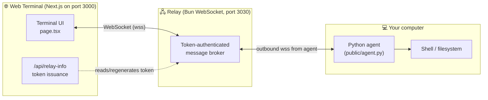

# AI Remote Terminal

[](LICENSE)
[](public/agent.py)
[](https://nextjs.org)
[](https://bun.sh)
[](#contributing)

A **secure, transparent remote terminal**: run a tiny Python agent on your own
computer and control it from a clean web terminal — streaming output, live
status, file retrieval, and a hard kill switch. Nothing is installed, nothing
persists, and every command is echoed locally before it runs.

> [!WARNING]
> **Ethical use only.** This tool gives shell access to whatever machine the
> agent runs on. Use it **only on computers you own or are explicitly
> authorized to administer**. The design is intentionally transparent — every
> command is printed in the agent window — because hidden access is never OK.

---

## Why this exists

Most remote-access answers are either heavy (TeamViewer, RDP) or opaque
(reverse shells, hidden daemons). This project takes a different stance:

| Principle | How it's honored |
|---|---|
| **Transparent** | Every command is printed in the agent console *before* it executes |
| **Ephemeral** | No service installation, no autostart, no persistence — `Ctrl+C` ends all access instantly |
| **Authenticated** | Every WebSocket connection must present a secret token; wrong tokens are rejected at the protocol level |
| **Encrypted** | The agent refuses plain `ws://` on public addresses — TLS (`wss://`) is enforced in production |
| **Consensual** | Optional `--confirm` mode asks y/n locally before executing *each* command |
| **Killable** | A Stop button terminates running commands; closing the agent kills the whole bridge |

## Architecture



- **Controllers** (browser tabs) send `exec` requests to the relay.
- The **relay** validates the token and forwards requests to the single
  connected **agent**, streaming every `stdout`/`stderr` chunk back to all
  controllers.
- The **agent** makes only an *outbound* connection to the relay — so it works
  behind NAT and firewalls without port-forwarding.

## Quick start

### 1 · Run the server

Requirements: [Node.js 20+](https://nodejs.org) (or [Bun](https://bun.sh)) and
[Bun](https://bun.sh) for the relay.

```bash
# install web terminal dependencies
npm install            # or: bun install

# start the WebSocket relay (port 3030)
bun run relay          # or: cd mini-services/remote-relay && bun run dev

# in a second terminal, start the web terminal (port 3000)
npm run dev
```

> **Production:** put the app behind a TLS reverse proxy — see
> [`Caddyfile.example`](Caddyfile.example). The web terminal builds agent
> commands as `wss://<your-host>/?XTransformPort=3030`; the bundled proxy
> pattern routes that query to the relay's local port.

### 2 · Connect your computer

Open the web terminal and follow the three steps on the right panel — it
generates the exact command for you:

```bash
pip install websockets
python agent.py --server wss://your-host/?XTransformPort=3030 --token <TOKEN>
```

| Flag | Description |
|---|---|
| `--server` | Relay websocket URL (shown in the web terminal) |
| `--token` | Access token — treat it like a password |
| `--confirm` | Ask **y/n locally before every command** (recommended when paranoid) |
| `--name` | Friendly machine name shown in the UI |
| `--insecure` | Allow plain `ws://` — **localhost testing only** |

### 3 · Control it

- Type commands (history via <kbd>↑</kbd>/<kbd>↓</kbd>) or use the OS-aware
  quick-command chips (the UI auto-switches between Windows/Unix sets).
- `sysinfo` — machine summary · `download <path>` — pull a file (≤ 10 MB) to
  your browser · `cd` persists between commands.
- **Stop** button kills the running command. Closing the agent ends access.

## Security model

- **Token lifecycle** — auto-generated on first server start
  (`mini-services/remote-relay/token.txt`, git-ignored). Regenerate it from
  the UI at any time; existing sockets stay alive, new connections require the
  new token.
- **Bad tokens are rejected** with WebSocket close code `4001` before any
  message is processed.
- **No secrets in transit without TLS** — the agent hard-refuses `ws://`
  unless you pass `--insecure` (for localhost).
- **One command at a time** — a running command blocks new ones until it exits
  or is stopped, and a 30-minute watchdog kills runaway processes.
- **Scope** — the agent connects *only* to the relay URL you give it. It never
  listens on a port; it can't be reached directly.

## WebSocket protocol

JSON text frames only. Two authenticated roles: `agent` and `controller`.

| Direction | Message | Purpose |
|---|---|---|
| client → server | `{"type":"hello","info":{…}}` | agent announces machine facts |
| controller → server | `{"type":"exec","command":"…","timeout":600}` | run a shell command |
| server → agent | `{"type":"exec","id":"…","command":"…","timeout":600}` | relayed, id assigned |
| agent → server | `{"type":"result","id":"…","event":"stdout\|stderr","data":"…"}` | streamed output |
| agent → server | `{"type":"result","id":"…","event":"exit","code":0,"cwd":"…"}` | command finished |
| agent → server | `{"type":"result","id":"…","event":"file","name":"…","b64":"…"}` | file transfer (base64) |
| controller → server | `{"type":"kill","id":"…"}` | stop a running command |
| server → controllers | `{"type":"agent_status","online":true,"info":{…}}` | presence broadcast |
| both | `{"type":"ping"} / {"type":"pong"}` | app-level heartbeat every 20 s |

Close codes: `4001` invalid token · `4002` unknown role · `1000` agent replaced
by a newer instance (the old one exits instead of reconnect-fighting).

## Project structure

```
ai-remote-terminal/
├── public/
│   └── agent.py                  # Python agent — the only thing that runs on your PC
├── src/
│   ├── app/
│   │   ├── page.tsx              # terminal UI (client component)
│   │   ├── layout.tsx            # metadata + fonts
│   │   ├── globals.css           # Tailwind 4 + shadcn theme tokens
│   │   └── api/relay-info/
│   │       └── route.ts          # token read / regenerate (GET, POST)
│   ├── components/ui/            # shadcn/ui primitives used by the terminal
│   ├── hooks/use-toast.ts
│   └── lib/utils.ts
├── mini-services/
│   └── remote-relay/
│       ├── index.ts              # Bun WebSocket relay (port 3030)
│       └── package.json
├── Caddyfile.example             # TLS reverse proxy with XTransformPort routing
├── next.config.ts
└── package.json
```

## Configuration

| Variable / file | Default | Purpose |
|---|---|---|
| `NEXT_PUBLIC_RELAY_QUERY` | `?XTransformPort=3030` | Websocket query used by the UI; override if your proxy routes differently |
| Relay port | `3030` | Hardcoded in `mini-services/remote-relay/index.ts` |
| Token store | `mini-services/remote-relay/token.txt` | Auto-created; regenerate from the UI |
| Web port | `3000` | `npm run dev` / `next start -p <port>` |

## Troubleshooting

| Symptom | Fix |
|---|---|
| `python: command not found` (Windows) | Use `py agent.py …` — the launcher is installed with python.org builds |
| `Missing dependency 'websockets'` | `pip install websockets` (Python 3.9+ required) |
| Badge says *waiting for agent* | Check the agent console for errors; confirm the URL/token match the web terminal |
| `Refusing insecure ws:// URL` | Expected on public addresses — serve over TLS (`Caddyfile.example`) |
| Garbled non-ASCII output | Your shell's codepage; try `python -X utf8 …` for Unicode-heavy commands |
| Agent exits with *another instance took over* | Two agents are running; only one may be connected at a time |

## Contributing

PRs are welcome! Ideas that fit the project's philosophy: PTY support (true
interactive sessions), multi-agent registry, per-command approval policies,
and optional end-to-end encryption on top of TLS. Please keep security fixes
responsible — open an issue first.

## مجوز و استفاده مسئولانه

این ابزار برای دسترسی به **کامپیوتر خودتان** یا سیستم‌هایی که اجازهٔ مدیریت
آن‌ها را دارید ساخته شده. هر دستور قبل از اجرا در پنجرهٔ ایجنت نمایش داده
می‌شود و با Ctrl+C همه‌چیز بلافاصله قطع می‌شود. هیچ چیز نصب یا ذخیره نمی‌شود.
لطفاً از آن فقط برای مقاصد مشروع استفاده کنید.

## License

[MIT](LICENSE) © Parsa (bokuwaparsa)
